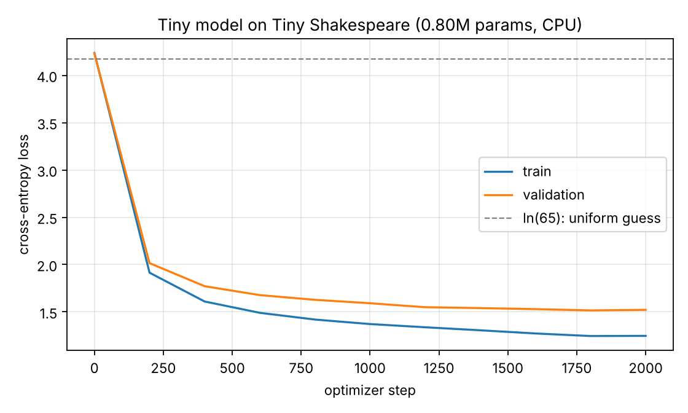
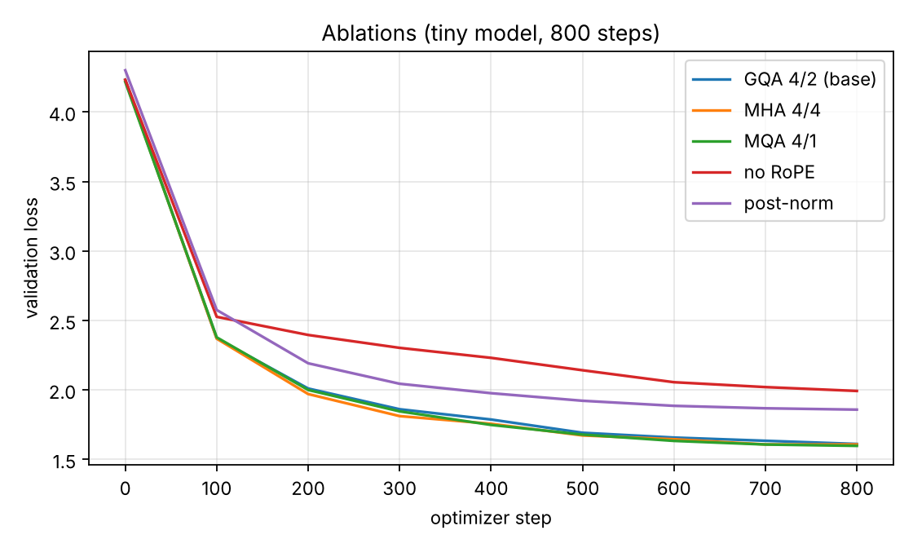

# AmineLM: a Mistral-style mini-GPT from scratch

A small language model written from scratch in PyTorch, following the architecture choices of
[Mistral 7B](https://arxiv.org/abs/2310.06825): RMSNorm, rotary embeddings (RoPE), grouped-query attention (GQA),
a SwiGLU feed-forward, pre-norm blocks, weight tying, and generation with a KV cache.
It trains on Tiny Shakespeare in about ten minutes on a laptop CPU.

I built it to understand every piece of a modern decoder-only LLM by writing it myself, with tests for each part
(32 unit tests, all on CPU in a few seconds).

## Results

Character-level model on Tiny Shakespeare (1.1M characters, last 10% held out for validation), trained on a 2-core CPU.

| run | params | steps | val loss | train speed |
|---|---|---|---|---|
| tiny (4 layers, d=128, 4 query heads / 2 K/V heads) | 0.80M | 2,000 | **1.515** | ~14,500 tokens/s |

For reference, the initial loss is ln(65) ≈ 4.17 (uniform guess over 65 characters).



Sample (prompt `ROMEO:`, temperature 0.8, top-k 50):

```
ROMEO:
Three fair sweetly dedect me have, in the strength
As with the bearers of this being some service
Match your wakes, and send the earness of thy depending
to a man in his gallant. I'll swear thee.

SICINIUS:
Thanks it there, he say that of me flesh with the
measure, my point of the queen of them marry.

HORTENSIO:
My lord,
Shall I provost not to my rage hears the excuses:
```

It has learned the format of a play (speaker names, line breaks, punctuation) and many real words,
which is about what one can expect from 0.8M parameters and ten minutes of CPU.

**KV cache.** Generating 1,000 tokens: 205 tokens/s without the cache, 457 tokens/s with it
(**×2.2**). With the cache, each step feeds a single new token instead of the whole context.
The gain is modest here because the context is only 128 tokens and the model is tiny; it grows with context length.

## Ablations

Same tiny model, 800 steps each, only one thing changed per run.



| variant | best val loss | what it shows |
|---|---|---|
| GQA, 4 query / 2 K/V heads (base) | 1.612 | reference |
| MHA, 4 / 4 | 1.608 | at this scale, sharing K/V heads costs nothing in loss |
| MQA, 4 / 1 | 1.598 | same: GQA/MQA only shrink the KV cache (×2 and ×4 here) |
| no RoPE | 1.993 | without position information (only the causal mask), the model is much worse |
| post-norm | 1.859 | pre-norm trains faster and more stably |

One seed per run, so differences of about 0.01 between GQA, MHA and MQA are within noise.

## Architecture

```
tokens -> tok_embeddings -> N x Block -> RMSNorm -> lm_head (tied to tok_embeddings) -> logits

Block (pre-norm):
  h   = x + Attention(RMSNorm(x))        # causal, GQA, RoPE on q and k
  out = h + SwiGLU(RMSNorm(h))           # w2(silu(w1 x) * w3 x)
```

- **RMSNorm** instead of LayerNorm: no mean subtraction, no bias, computed in float32.
- **RoPE**: each pair of dimensions of q and k is rotated by an angle proportional to the position, so
  q_m · k_n only depends on m − n. Interleaved pairs, as in `mistral-inference`.
- **GQA**: 4 query heads share 2 key/value heads. The KV cache is twice smaller than with standard attention.
- **KV cache**: one prefill pass on the prompt, then one token per forward call. When the context is full,
  generation continues on a sliding window.
- **Training**: AdamW (weight decay only on matrices), linear warmup then cosine decay, gradient clipping,
  gradient accumulation, bf16 autocast on GPU, best checkpoint kept on validation loss.

## Project layout

```
minigpt/
  tokenizer.py     character tokenizer + byte-level BPE (train / encode / decode)
  data.py          uint16 .bin files read with memmap, random (x, y) batches
  layers.py        RMSNorm, RoPE, Attention (GQA + KV cache), SwiGLU
  model.py         Block, GPT, optimizer groups, generate()
  sampling.py      temperature, top-k, top-p
  train_utils.py   learning-rate schedule, loss estimation
  config.py        GPTConfig and presets
scripts/           prepare_shakespeare.py, train.py, sample.py, plot.py
tests/             one test file per part (shapes, causality, reference attention, KV cache, ...)
```

## Run it

```bash
pip install -r requirements.txt
python scripts/prepare_shakespeare.py                       # downloads Tiny Shakespeare, writes data/shakespeare/
python scripts/train.py --preset tiny --max_iters 2000      # ~10 min on CPU, faster on a Mac (MPS) or GPU
python scripts/sample.py --prompt "ROMEO:" --n 400 --top_k 50
pytest -q
```

Ablations: `--n_kv_head 4` (MHA), `--n_kv_head 1` (MQA), `--no_rope`, `--post_norm`, `--no_tie`,
then `python scripts/plot.py out/run_a out/run_b --out assets/compare.png`.
On a GPU, `--preset small --flash` trains a ~10M-parameter model.

## What the tests check

- the BPE tokenizer merges the most frequent pair first, applies merges in learned order and round-trips Unicode;
- batches are shifted by exactly one token;
- RoPE matches the closed-form angles, keeps norms and only depends on relative positions;
- attention matches a PyTorch reference (`scaled_dot_product_attention`) and is causal;
- the initial loss is close to ln V and the model can overfit a single batch;
- generation with the KV cache gives exactly the same greedy output as without it, with one token per step.

## References

- Jiang et al., *Mistral 7B* (2023) and [mistral-inference](https://github.com/mistralai/mistral-inference)
- Su et al., *RoFormer: Enhanced Transformer with Rotary Position Embedding* (2021)
- Ainslie et al., *GQA: Training Generalized Multi-Query Transformer Models* (2023)
- Shazeer, *GLU Variants Improve Transformer* (2020)
- Zhang & Sennrich, *Root Mean Square Layer Normalization* (2019)
- Karpathy, [nanoGPT](https://github.com/karpathy/nanoGPT) and [minbpe](https://github.com/karpathy/minbpe)
